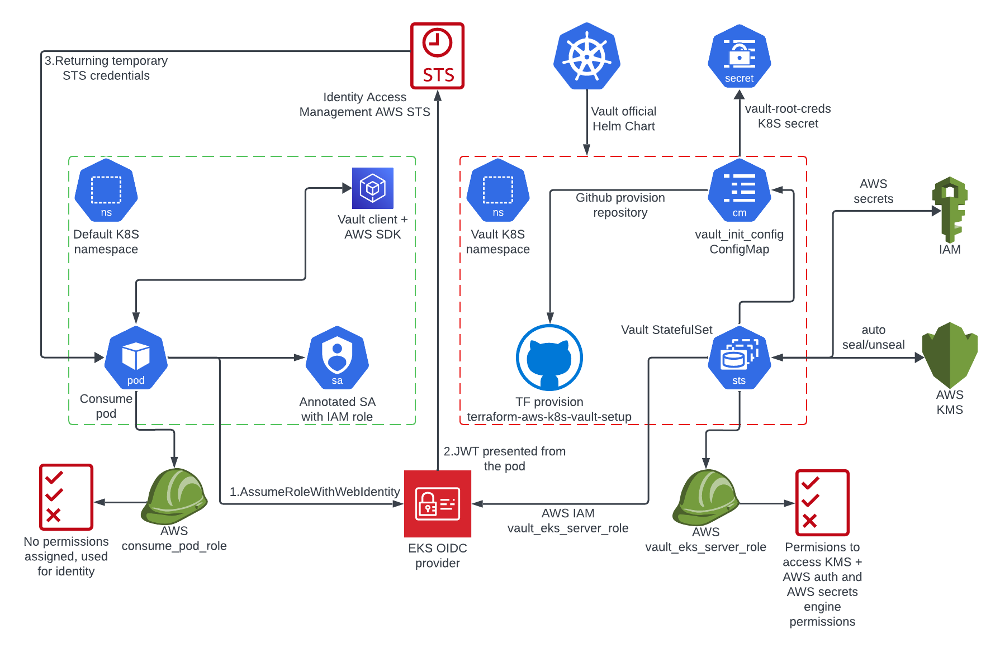

## Simple PoC project that deploys the official Vault helm chart and configures the Vault server for usage in AWS EKS
-----


### What is it:
  This project utilizes already existing EKS AWS cluster to deploy the official Vault Helm chart, setting up AWS IRSA accounts (IAM roles for service accounts (IRSA)) for Vault AWS auth method, Vault AWS secrets engine and auto Seal/Unseal functionality. 
  In addition to above-mentioned setup, a consuming Pod named `consume-pod-<random_pet>` is created, which can authenticate to the Vault server effortlessly simply via `vault login -method=aws` command.

### Simple diagram:


### Simple diagram (Mermaid version):

```mermaid
flowchart TB
    subgraph EXT["External Provisioning"]
        GH["GitHub Repository<br/><code>git_repository</code><br/>(Terraform Vault Config)"]
    end

    subgraph AWS["AWS Cloud Infrastructure"]
        subgraph AWS_IAM["AWS IAM & Security"]
            OIDC["EKS OIDC Provider<br/><code>sts:AssumeRoleWithWebIdentity</code>"]
            STS["AWS STS<br/><code>GetCallerIdentity / AssumeRole</code>"]
            KMS["AWS KMS CMK<br/><code>awskms</code> Auto-Unseal & Recovery"]
            IAM_SVC["AWS IAM Service<br/>Dynamic Users & Access Keys"]

            subgraph IAM_ROLES["IAM Roles (IRSA)"]
                V_ROLE["Vault Server IAM Role<br/><code>vault-eks-server-role</code><br/>• KMS Auto-Unseal<br/>• AWS Auth Validation<br/>• AWS Secrets Engine Mgmt"]
                C_ROLE["Consume Pod IAM Role<br/><code>consume-pod-role</code><br/>• Identity for Vault AWS Auth"]
            end
        end

        subgraph AWS_INGRESS["External Access (Optional)"]
            ACM["AWS ACM<br/>Public TLS Certificate"]
            ALB["AWS Application Load Balancer<br/>(AWS Load Balancer Controller)"]
        end
    end

    subgraph K8S["EKS Kubernetes Cluster"]
        subgraph V_NS["Vault Namespace"]
            subgraph V_STS["Vault StatefulSet (3 HA Replicas)"]
                direction TB
                subgraph POD0["Vault Pod *-0 (Leader / Provisioner)"]
                    direction TB
                    INIT0["Init Containers:<br/>1. git-clone (GitHub repo)<br/>2. terraform init (K8S state backend)"]
                    POST0["postStart Hook (run.sh):<br/>• vault operator init (KMS unseal)<br/>• Download TF binary<br/>• Write vault-root-creds Secret<br/>• terraform apply (AWS auth / secrets)"]
                    V0["Vault Server 0<br/>(Active / Raft Leader)"]
                    INIT0 --> POST0 --> V0
                end

                subgraph PODN["Vault Pods *-1 / *-2 (Standbys)"]
                    direction TB
                    INITN["Init Containers:<br/>1. git-clone<br/>2. terraform init"]
                    POSTN["postStart Hook (run.sh):<br/>• Wait for vault-root-creds<br/>• Cache ~/.vault-token"]
                    VN["Vault Server Standbys<br/>(Raft Followers)"]
                    INITN --> POSTN --> VN
                end

                V0 <-->|"Raft Consensus & Auto-Join<br/>(Internal mTLS :8201)"| VN
            end

            subgraph V_STORAGE["K8S Secrets, Storage & State"]
                V_TLS["Secret: <code>vault-server-tls</code><br/>(Server TLS Cert + Key + CA)"]
                V_ROOT["Secret: <code>vault-root-creds</code><br/>(Root Token & Recovery Key)"]
                V_LIC["Secret: <code>vault-ent-license</code><br/>(Enterprise License)"]
                TF_STATE["Secret & Lease:<br/><code>tfstate-default-tf-provision-state</code><br/>(K8S Backend State Lock)"]
                PVC["PersistentVolumeClaims<br/>(1Gi Raft Storage per Pod)"]
            end

            subgraph V_NET_OBS["Networking & Observability"]
                SVC_INT["Headless Service:<br/><code>vault-internal</code> (:8200/:8201)"]
                SVC_ACT["Service: <code>vault-active</code> / <code>vault-standby</code>"]
                MON["Prometheus Operator<br/>• ServiceMonitor (/v1/sys/metrics)<br/>• PrometheusRule (Alerts)"]
            end
        end

        subgraph C_NS["Consumer Namespace"]
            subgraph C_POD["Consume Pod"]
                direction TB
                C_CLIENT["Vault Client / Go SDK Consumer<br/>• Injected AWS WebIdentity Token<br/>• LifetimeWatcher (Auto-Renew)<br/>• AuthManager (Auto-Relogin)"]
            end
            C_SA["ServiceAccount: <code>consume-sa</code><br/><code>eks.amazonaws.com/role-arn</code>"]
            C_CA["Secret: <code>vault-ca-cert</code><br/>(Internal CA Cert)"]
        end
    end

    %% Init & Provisioning Connections
    GH -.->|"1. git clone TF code"| INIT0
    GH -.->|"git clone TF code"| INITN
    POST0 -->|"Persist State & Lock"| TF_STATE
    POST0 -->|"Store Root Token & Recovery Key"| V_ROOT
    POSTN -->|"Read Root Token"| V_ROOT
    V_TLS -.->|"Internal TLS Certs"| V_STS
    V_LIC -.->|"Enterprise License"| V_STS
    PVC -.->|"Raft Data Mount (/vault/data)"| V_STS
    C_CA -.->|"Mount CA Certificate"| C_CLIENT
    C_SA -.->|"Annotated SA"| C_CLIENT

    %% Ingress Connections
    ACM -.->|"TLS Certificate"| ALB
    ALB -->|"HTTPS :8200 (Internal TLS)"| SVC_ACT
    SVC_ACT --> V0

    %% Telemetry
    V_TLS -.->|"CA Trust"| MON
    MON -->|"Scrape Metrics (HTTPS :8200)"| SVC_INT
    SVC_INT --> V_STS

    %% AWS IRSA & Integrations
    V_STS -->|"IRSA Token Exchange"| OIDC
    OIDC -->|"AssumeRoleWithWebIdentity"| V_ROLE
    V_ROLE -->|"KMS Auto-Unseal / Encrypt / Decrypt"| KMS
    V_ROLE -->|"Verify IAM Caller Identity"| STS
    V_ROLE -->|"Manage Dynamic IAM Users & Keys"| IAM_SVC

    %% Consumer Auth Flow
    C_CLIENT -->|"1. Projected WebIdentity Token"| OIDC
    OIDC -->|"2. AssumeRole"| C_ROLE
    C_ROLE -->|"3. Signed STS GetCallerIdentity Request"| STS
    C_CLIENT -->|"4. vault login -method=aws (HTTPS :8200)"| SVC_ACT
    V0 -->|"5. Validate STS Signature"| STS
    V0 -->|"6. Return Vault Token"| C_CLIENT
    C_CLIENT -->|"7. Request AWS Secrets / KV Data"| V0

    %% Styling
    classDef k8s fill:#326ce5,stroke:#1a4291,color:#fff;
    classDef aws fill:#e07a1e,stroke:#a6530a,color:#fff;
    classDef vault fill:#24292e,stroke:#000,color:#fff;
    classDef sec fill:#0284c7,stroke:#0369a1,color:#fff;
    classDef ext fill:#4b5563,stroke:#374151,color:#fff;
    classDef hook fill:#0d9488,stroke:#0f766e,color:#fff;
    classDef mon fill:#6366f1,stroke:#4338ca,color:#fff;

    class ALB,ACM,OIDC,STS,KMS,IAM_SVC,V_ROLE,C_ROLE,AWS_IAM,AWS_INGRESS,IAM_ROLES aws;
    class V_TLS,V_ROOT,V_LIC,TF_STATE,PVC,C_CA,C_SA sec;
    class V0,VN,C_CLIENT vault;
    class INIT0,POST0,INITN,POSTN hook;
    class SVC_INT,SVC_ACT,MON mon;
    class GH ext;
```


### Prerequisites:
  - Having AWS account
  - Pre-configured AWS EKS cluster with associated OIDC provider. Instructions on how to setup EKS cluster and OIDC provider for it can be found [here](https://docs.aws.amazon.com/eks/latest/userguide/getting-started-eksctl.html) and [here](https://docs.aws.amazon.com/eks/latest/userguide/enable-iam-roles-for-service-accounts.html) 
  - Terraform >= 1.16.2, < 1.17.0 (constraint: `~>1.16.2`)
  - A Terraform Github repository which resembles [this](https://github.com/martinhristov90/terraform-aws-k8s-vault-setup), containing Vault TF provider resources to be deployed on the Vault server. The mentioned repository can be used as boilerplate.

### Usage:
  - Clone the repository: `git clone https://github.com/martinhristov90/vault-aws-eks-irsa`.
  - Change into its directory: `cd vault-aws-eks-irsa`.
  - Create `terraform.tfvars` file, example of how it should look like can be found below. 
  - Make sure that you are already authenticated to the K8S cluster and you have the desired K8S context set as "current", you can do this with `kubectl config current-context` and `kubectl get pods`(example) commands.
  - Initialize Terraform providers: `terraform init`.
  - Execute Terraform plan and apply: `terraform plan` and `terraform apply`.
  - Terraform logs will be printed at `stdout` of `0`th Pod of Vault's StatefulSet. To follow initialization progress:
    ```
    kubectl logs -f -n <vault_namespace> -c vault <release-name>-0
    ```
  - For establishing sessions with the Vault server and `consume-pod-<random_pet>`, `kubectl exec...` command can be utilized or 3rd party tools, such as [k9s](https://github.com/derailed/k9s).

### Deploying multiple instances on the same cluster:
  Several independent instances of this setup can be deployed on the same EKS cluster. Resources that are named with the `random_pet` suffix (Helm release, IAM roles/policies, KMS key, Roles, consume Pod, consume ServiceAccount `<consume_pod_sa_name>-<random_pet>`, CA secret `vault-ca-cert-<random_pet>`) do not collide between instances. For every additional instance:
  - Use a separate Terraform state, so each instance gets its own `random_pet`, for example a new workspace: `terraform workspace new <name>`, or a separate copy of the repository.
  - Set a different `vault_namespace` (and `consume_pod_namespace`, if it is not shared) in `terraform.tfvars`, as the namespace, `vault-tls`, `vault-root-creds` and `vault-ent-license` secrets have fixed names.
  - If `ingress_enable = true`, set a different `ingress_lb_name` and `ingress_hosted_zone`, as the ALB name and the `vault.<ingress_hosted_zone>` hostname must be unique.
### `terraform.tfvars` explanation and example:

  | Variable | Example | Meaning |
  | --- | - | --- |
  |k8s_cluster_name| k8s-training-martin|Name of EKS AWS kubernetes cluster, already deployed in AWS|
  |aws_region|eu-central-1|AWS region where the EKS cluster is deployed|
  |sa_name|vault-server|Name of K8S SA used by the Vault server Pods|
  |vault_namespace|vault|K8S namespace where the whole Vault instance is deployed (Helm release, TLS/license/root-creds secrets, RBAC) — created by this Terraform configuration via `k8s_namespace.tf`. Also used to derive the Ingress hostname and ALB name|
  |consume_pod_namespace|default|K8S namespace where the consume Pod should be deployed, usually default|
  |consume_pod_sa_name|demo-sa|Prefix of the K8S SA used by the consume Pod, the final name is `<consume_pod_sa_name>-<random_pet>` (default is used when the variable is omitted)|
  |vault_helm_chart_version|0.34.1|Version of the official Vault Helm chart to be used|
  |vault_version|2.0.4|Version of Vault to be installed|
  |enable_prometheus_servicemonitor|true|Enables deployment of ServiceMonitor resource when the Prometheus operator is installed in the K8S cluster|
  |enable_vault_benchmark|false|Enables the Vault benchmark suite. When `true`, deploys a dedicated `ClusterIP` service pointing at the Vault StatefulSet and a `kubernetes_job` running `hashicorp/vault-benchmark:latest`. The benchmark configuration is managed in `vault_benchmark/main.tf`.|
  |ingress_enable|false|Enables deployment Ingress resource via Vault's Helm chart, this usually results in creation of ALB in AWS|
  |ingress_hosted_zone|mhristov.sbx.hashidemos.io|Hosted zone for issuing publicly trusted TLS certificate used by the Ingress resource|
  |ingress_lb_name|marti-test-alb-vault-k8s|Name of the ALB created in AWS|
  |vault_type|ent|Determines whether Vault server should be OSS or ENT|
  |DEMOROLE_POLICY_ARN|arn:aws:iam::ACC_ID_HERE:policy/DemoUser|ARN of Policy used the Vault's AWS secrets engine to create demo IAM users, that policy usually preexists with all Doormat accounts. Specifies the [policy_arns](https://developer.hashicorp.com/vault/api-docs/secret/aws#policy_arns) parameter for `iam_user` type role|
  |DEMOROLE_ROLE_ARN|arn:aws:iam::ACC_ID_HERE:role/vault-assumed-role-credentials-demo|Name of the AWS IAM role used to create STS credentials by the Vault's AWS secrets engine. Specifies the [role_arns](https://developer.hashicorp.com/vault/api-docs/secret/aws#role_arns) parameter for `assumed_role` type role |
  |INFERRED_AWS_REGION|us-east-2|Specifies [inferred_aws_region](https://developer.hashicorp.com/vault/api-docs/auth/aws#inferred_aws_region) parameter of AWS auth method (EC2 type)|
  |BOUND_VPC_IDS|vpc-0575842261fba092a|Specifies the [bound_vpc_id](https://developer.hashicorp.com/vault/api-docs/auth/aws#bound_vpc_id) parameter for AWS auth method (EC2 type)|
  |git_repository|https://github.com/martinhristov90/terraform-aws-k8s-vault-setup|Git repository used containing Terraform configuration for provisioning the Vault server, AWS auth, AWS secrets, etc.|

#### Example `terraform.tfvars` file:
  ```
  k8s_cluster_name                 = "k8s-training-martin"
  aws_region                       = "eu-central-1"
  sa_name                          = "vault-server"
  vault_namespace                  = "vault"
  consume_pod_namespace            = "default"
  vault_helm_chart_version         = "0.34.1"
  vault_version                    = "2.0.4"
  vault_type                       = "ent"
  enable_prometheus_servicemonitor = true
  enable_vault_benchmark           = false
  ingress_enable                   = false
  ingress_hosted_zone              = "mhristov.sbx.hashidemos.io"
  ingress_lb_name                  = "marti-test-alb-vault-k8s"
  DEMOROLE_POLICY_ARN              = "arn:aws:iam::1<SNIP>33:policy/DemoUser"
  DEMOROLE_ROLE_ARN                = "arn:aws:iam::1<SNIP>33:role/vault-assumed-role-credentials-demo"
  INFERRED_AWS_REGION              = "us-east-2"
  BOUND_VPC_IDS                    = "vpc-057<SNIP>1fba092a"
  git_repository                   = "https://github.com/martinhristov90/terraform-aws-k8s-vault-setup"
  ```

-----

### How to consume this environment (consume-pod side):
- After setting up correctly the `terraform.tfvars` file and executing `terraform apply` command, in the EKS are deployed three Vault server Pods (part of StatefulSet) as well as consuming Pod for Vault secrets named `consume-pod-<random_pet>` (for example `consume-pod-joint-racer`).
- To verify the running Vault pods - `kubectl get pods -l component=server -n vault`:
```
kubectl get pods -l component=server -n vault
NAME                         READY   STATUS    RESTARTS   AGE
vault-server-joint-racer-0   1/1     Running   0          3h
vault-server-joint-racer-1   1/1     Running   0          3h
vault-server-joint-racer-2   1/1     Running   0          3h
```
- To verify that the `consume-pod-<random_pet>` is running - `kubectl get pods consume-pod-joint-racer -n default`:
```
kubectl get pods consume-pod-joint-racer -n default
NAME                      READY   STATUS    RESTARTS   AGE
consume-pod-joint-racer   1/1     Running   0          3h2m
```
- Execute a session on `consume-pod-<random_pet>` Pod:
```
kubectl exec -it consume-pod-joint-racer -- /bin/sh
```
- Login to Vault server via `vault login -method=aws` command without providing any additional parameters to the command (VAULT_ADDR is preset):
```
kubectl exec -it consume-pod-joint-racer -- /bin/sh
/ # vault login -method=aws
Success! You are now authenticated. The token information displayed below
is already stored in the token helper. You do NOT need to run "vault login"
again. Future Vault requests will automatically use this token.

Key                      Value
---                      -----
token                    hvs.CAESIO7u1UPzAGfqBh3-A<SNIP>MG1XRzAzbFhyaEFqSWhiSzc
token_accessor           nE1eOun6WoHk89iSeh1td7At
token_duration           1m
token_renewable          true
token_policies           ["aws-secrets" "default"]
identity_policies        []
policies                 ["aws-secrets" "default"]
token_meta_account_id    123361688033
token_meta_auth_type     iam
token_meta_role_id       38bfc32a-4276-df35-a798-bd23336446e9
```
- Request a demo `iam_type` role via AWS secrets engine:
```
 vault read aws/creds/demo_aws_secrets_role
Key                Value
---                -----
lease_id           aws/creds/demo_aws_secrets_role/sxrZGgEWa<SNIP>9Cd5jw
lease_duration     768h
lease_renewable    true
access_key         AKIA<SNIP>
secret_key         Rou4j<SNIP>HRLvC
security_token     <nil>
```
- Request `assumed_role` role via AWS secrets engine:
```
 vault read aws/creds/demo_aws_secrets_role_assumed_role
Key                Value
---                -----
lease_id           aws/creds/demo_aws_secrets_role_assumed_role/rTRWSe<SNIP>ANhIAYm
lease_duration     15m
lease_renewable    false
access_key         ASI<SNIP>Z5P
arn                arn:aws:sts::12<SNIP>33:assumed-role/vault-assumed-role-credentials-demo/vault-aws-consume-pod-role-joint-racer_171439663-1714396688-yD6O
secret_key         56+jZZLtC<SNIP>i/f1N
security_token     IQoJb3J<SNIP>+wFU3ApNoTxVf6QmvfT6i6PGhwrTCQvL6xBjqeAdHYe1V/Sb8g+zbrw+KpKzmJuC+oLTfcZ+gTnZMaFR2mLDSN87swkxRNSH/EoB/6dB/srj0poG0XFNVX3ijjbxROIQicKzDUXgFnP46nniKKsDJJ1aUofR3onANOxSMDHlAZDNkSa5XLyMV+P9ECfl21PHRSrZjUrR+HFwBARzcTih1wPEfxk5M+UqQ8/RQXFlCqvD94H5ZjHnQZGFaR
```

- Run the Go SDK consumer example on `consume-pod-<random_pet>` (demonstrating IRSA login, `LifetimeWatcher` token renewal, and KV secret retrieval):
```bash
# From the repository root or go_example directory:
cd go_example && ./upload_and_run.sh
```
See [`go_example/README.md`](go_example/README.md) for full details.

### How to consume this environment (Vault server side):
- The root token is cached in `~/.vault-token` on Pod `0` of the StatefulSet. Both the root token and the recovery key are persisted in the `vault-root-creds` Kubernetes secret in the target namespace and can be sourced from there.
- Fetching root key and unseal keys from the K8S secret:
```
base64 -d <<< $(kubectl get secret vault-root-creds -n vault -o json | jq -r .data.root_token)
base64 -d <<< $(kubectl get secret vault-root-creds -n vault -o json | jq -r .data.recovery_key)
```
- As already mentioned upon establishing a session to Pod `0`, Vault is already unsealed and `root` token is set in the `~/.vault-token` file in the home directory, ready to be used:
    - Expected `vault status -format=json` output:
        ```json
        {
          "type": "awskms",
          "initialized": true,
          "sealed": false,
          "t": 1,
          "n": 1,
          "progress": 0,
          "nonce": "",
          "version": "1.15.4",
          "build_date": "2023-12-04T17:45:28Z",
          "migration": false,
          "cluster_name": "vault-cluster-6c15b226",
          "cluster_id": "56311cd5-0db2-3efb-230d-65bb083846ae",
          "recovery_seal": true,
          "recovery_seal_type": "shamir",
          "storage_type": "raft",
          "ha_enabled": true,
          "is_self": true,
          "active_time": "2024-04-29T10:10:43.050455939Z",
          "leader_address": "http://192.168.69.198:8200",
          "leader_cluster_address": "https://vault-server-joint-racer-0.vault-server-joint-racer-internal:8201",
          "raft_committed_index": 315,
          "raft_applied_index": 315
        }
        ```
    - Expected `vault token lookup -format=json` output:
        ```
        {
          "request_id": "c174d0d0-a69c-9dd1-8f28-ded0e7a8a378",
          "lease_id": "",
          "lease_duration": 0,
          "renewable": false,
          "data": {
            "accessor": "S9Cjq7nOslAvEdeedjiKLyuE",
            "creation_time": 1714385442,
            "creation_ttl": 0,
            "display_name": "root",
            "entity_id": "",
            "expire_time": null,
            "explicit_max_ttl": 0,
            "id": "hvs.sIbHXfxZ9ODrwColBynGNLZm",
            "meta": null,
            "num_uses": 0,
            "orphan": true,
            "path": "auth/token/root",
            "policies": [
              "root"
            ],
            "ttl": 0,
            "type": "service"
          },
          "warnings": null
        }
        ```
- Further configurations can be made to the Vault server utilizing the `root` token or subsequently issued child tokens.
-----
### Terraform state persistence across Pod `*-0` restarts

TF state is stored as a K8S Secret using the [Terraform Kubernetes backend](https://developer.hashicorp.com/terraform/language/settings/backends/kubernetes), surviving pod restarts. The namespace is injected dynamically at init time from the pod's service account so the config is not hardcoded.

- **`k8s_tf_role.tf`** — dedicated `role_tf_state` Role + RoleBinding scoped to `tfstate-default-tf-provision-state` (secret) and `lock-tfstate-default-tf-provision-state` (lease). `create`/`list` are namespace-wide due to a K8S RBAC limitation.
- **`values_vault.yaml`** — init container passes `-backend-config="namespace=$(cat /var/run/secrets/kubernetes.io/serviceaccount/namespace)"` to `terraform init`.
- **`run.sh`** — on Pod `*-0` restarts, the recovery key is restored from `vault-root-creds` to `~/.vault-recovery-key` before `terraform apply`.

#### Required change in `git_repository`

Add to `terraform.tf` in the [`git_repository`](https://github.com/martinhristov90/terraform-aws-k8s-vault-setup):

```hcl
terraform {
  backend "kubernetes" {
    secret_suffix     = "tf-provision-state"
    in_cluster_config = true
  }
}
```

-----
### TODO:
  - [x] Configure optional Ingress resource + cert
  - [x] Add ServiceMonitor resource for Prometheus operator
  - [x] Deploy ServiceMonitor via Vault's Helm chart
  - [x] Persist Terraform state across Pod `*-0` restarts using the Kubernetes backend
  - [x] Implement internal TLS, so the communication is encrypted between ALB and Vault pods, as well as Pods within the cluster
### License:
  - [MIT](https://choosealicense.com/licenses/mit/)