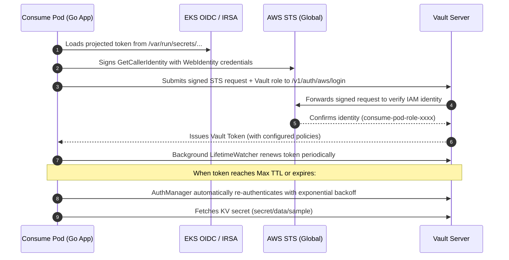

# HashiCorp Vault Go SDK Client - IRSA AWS Auth & Auto-Relogin

This Go example demonstrates how an application running inside an AWS EKS pod (`consume-pod-<random_pet>`) authenticates to HashiCorp Vault using **AWS IAM Authentication with IAM Roles for Service Accounts (IRSA)**, maintains continuous token renewals via **`api.LifetimeWatcher` (Token Watcher)**, automatically re-authenticates with exponential backoff (`cenkalti/backoff`) when tokens expire or reach maximum TTL, and queries secrets from Vault.

---

## Architecture & Authentication Flow



---

## Prerequisites

- Kubernetes cluster (EKS) with Vault deployed via the Terraform configuration in this repository.
- `consume-pod-<random_pet>` deployed in the cluster (default namespace: `default`).
- `kubectl` configured with cluster access.
- Go 1.21+ installed on your local workstation.

---

## Quick Start: Build, Upload, and Run

From the `go_example/` directory, simply run:

```bash
./upload_and_run.sh
```

Or using `make`:

```bash
make run
```

The script will:
1. Dynamically discover the running consume pod (`consume-pod-*`) in the target namespace.
2. Detect the target pod and node architecture (`amd64` / `arm64`).
3. Cross-compile a static Linux Go binary (`bin/vault-go-consumer`).
4. Copy the binary to `/tmp/vault-go-consumer` on the pod using `kubectl cp`.
5. Execute the binary inside the pod using `kubectl exec`.

You can also specify a custom pod name or namespace:
```bash
POD_NAME=consume-pod-summary-tetra POD_NAMESPACE=default ./upload_and_run.sh
```

---

## Step-by-Step Code Explanation

### 1. Configuration & Auto-Discovery (`loadConfig()`)

```go
func loadConfig() *Config {
    cfg := &Config{
        VaultAddr:     os.Getenv("VAULT_ADDR"),
        VaultCACert:   os.Getenv("VAULT_CACERT"),
        RoleName:      os.Getenv("VAULT_ROLE"),
        AuthMountPath: os.Getenv("VAULT_AUTH_MOUNT_PATH"),
        STSRegion:     os.Getenv("VAULT_STS_REGION"),
        KVMountPath:   os.Getenv("KV_MOUNT_PATH"),
        KVSecretPath:  os.Getenv("KV_SECRET_PATH"),
        CheckInterval: 30 * time.Second,
    }
    ...
    // If VAULT_ROLE is not explicitly provided, attempt to derive it from AWS_ROLE_ARN
    if cfg.RoleName == "" {
        if roleArn := os.Getenv("AWS_ROLE_ARN"); roleArn != "" {
            parts := strings.Split(roleArn, "/")
            cfg.RoleName = parts[len(parts)-1]
        }
    }
    return cfg
}
```

- Reads standard in-cluster environment variables (`VAULT_ADDR`, `VAULT_CACERT`, `VAULT_AUTH_MOUNT_PATH`, `KV_MOUNT_PATH`, `KV_SECRET_PATH`).
- **IRSA Role Auto-Discovery**: When AWS EKS IRSA is active, the EKS Pod Identity Webhook automatically injects `AWS_ROLE_ARN` (e.g. `arn:aws:iam::123456789012:role/consume-pod-role-summary-tetra`). The code automatically extracts the role name (`consume-pod-role-summary-tetra`) to match `var.ROLE_NAME` in Vault's AWS auth backend.

---

### 2. Vault Client Initialization

```go
vaultConfig := vault.DefaultConfig()
if cfg.VaultAddr != "" {
    vaultConfig.Address = cfg.VaultAddr
}
if err := vaultConfig.ReadEnvironment(); err != nil {
    log.Fatalf("[Error] Failed to read Vault environment settings: %v", err)
}
client, err := vault.NewClient(vaultConfig)
```

- `vault.DefaultConfig()` initializes default SDK settings.
- `ReadEnvironment()` automatically configures mTLS and CA trust from `VAULT_CACERT` (`/vault/tls/ca.crt`) mounted into the pod.

---

### 3. Background Auth Manager with Auto-Relogin & Exponential Backoff

```go
func runAuthManager(ctx context.Context, client *vault.Client, cfg *Config, initialAuthCh chan struct{}) {
    for {
        if ctx.Err() != nil {
            return
        }

        // Exponential backoff configuration using cenkalti/backoff
        expBackoff := backoff.NewExponentialBackOff()
        expBackoff.InitialInterval = 1 * time.Second
        expBackoff.MaxInterval = 30 * time.Second
        expBackoff.MaxElapsedTime = 0 // Retry indefinitely until context cancelled

        loginOp := func() error {
            secret, err := loginAWS(ctx, client, cfg)
            if err != nil {
                return err
            }
            authSecret = secret
            return nil
        }

        if err := backoff.RetryNotify(loginOp, backoff.WithContext(expBackoff, ctx), notifyOp); err != nil {
            return
        }

        client.SetToken(authSecret.Auth.ClientToken)

        // Start LifetimeWatcher and block until lease expires or max_ttl reached
        watcher, _ := client.NewLifetimeWatcher(&vault.LifetimeWatcherInput{Secret: authSecret})
        go watcher.Start()
        watchErr := watchTokenLifecycle(ctx, watcher)
        watcher.Stop()

        // Loop automatically triggers fresh login for a new token
    }
}
```

- **Exponential Backoff**: Uses `github.com/cenkalti/backoff/v4` to retry authentication automatically upon network or Vault service disruptions without crashing the application.
- **Auto Re-Authentication**: When a token reaches its maximum TTL (`max_ttl`) or is revoked, `LifetimeWatcher` terminates and the outer loop immediately triggers a fresh IRSA login, ensuring uninterrupted secret access for long-running services.

---

### 4. Automated Token Renewal via `LifetimeWatcher`

```go
func watchTokenLifecycle(ctx context.Context, watcher *vault.LifetimeWatcher) error {
    for {
        select {
        case <-ctx.Done():
            return nil
        case err, ok := <-watcher.DoneCh():
            if !ok {
                return nil
            }
            return err
        case renewal, ok := <-watcher.RenewCh():
            if !ok {
                return nil
            }
            log.Printf("[TokenWatcher] Token renewed! Remaining lease: %ds", renewal.Secret.Auth.LeaseDuration)
        }
    }
}
```

- `LifetimeWatcher` calculates lease TTL and automatically triggers `auth/token/renew-self` before expiration (typically at 2/3 of lease duration).
- Receives events via `RenewCh()` on successful renewal and `DoneCh()` when the lease completes or fails.

---

### 5. Fetching Sample KV Secrets (`fetchKVSecret()`)

```go
secret, err := client.KVv2(mountPath).Get(ctx, secretPath)
if err == nil && secret != nil && secret.Data != nil {
    for k, v := range secret.Data {
        log.Printf("  ├── %s: %v", k, v)
    }
    return
}
```

- Queries the KV v2 endpoint at `${KV_MOUNT_PATH}/data/${KV_SECRET_PATH}`.
- If KV v2 is not mounted or path structure differs, it falls back to a direct `client.Logical().ReadWithContext(ctx, path)`.
- If the token lacks permission (e.g. KV policy not attached), it logs a descriptive message explaining that `read` permission on `secret/*` is required.

---

### 6. Monitoring Loop & Signal Handling

```go
sigChan := make(chan os.Signal, 1)
signal.Notify(sigChan, os.Interrupt, syscall.SIGTERM)

ticker := time.NewTicker(cfg.CheckInterval)
defer ticker.Stop()

for {
    select {
    case <-sigChan:
        log.Println("Received termination signal. Exiting gracefully...")
        cancel()
        wg.Wait()
        return
    case <-ticker.C:
        fetchKVSecret(ctx, client, cfg.KVMountPath, cfg.KVSecretPath)
    }
}
```

- Captures `SIGINT` (Ctrl+C) and `SIGTERM` for clean shutdown.
- Periodically queries Vault every 30 seconds to demonstrate ongoing authenticated access while the background auth manager maintains tokens.

---

## Configuration Options (Environment Variables)

The application automatically reads configuration from environment variables present in `consume-pod`:

| Variable | Default Value | Description |
|---|---|---|
| `VAULT_ADDR` | Injected in pod (`https://vault-server-...:8200`) | Vault server API address |
| `VAULT_CACERT` | Injected in pod (`/vault/tls/ca.crt`) | Path to the Vault internal CA certificate |
| `AWS_ROLE_ARN` | Injected by EKS IRSA | IAM Role ARN assumed by the pod |
| `VAULT_ROLE` | Auto-derived from `AWS_ROLE_ARN` | Vault AWS auth role name |
| `VAULT_AUTH_MOUNT_PATH` | `aws` | Mount path for Vault AWS auth engine |
| `VAULT_STS_REGION` | `us-east-1` (global) | AWS STS signing region (use only if custom regional STS endpoint is set in Vault) |
| `KV_MOUNT_PATH` | `secret` | Mount path for KV secrets engine |
| `KV_SECRET_PATH` | `sample` | Path to sample KV secret to fetch |
